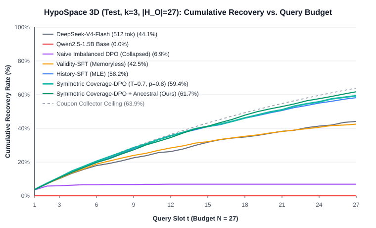
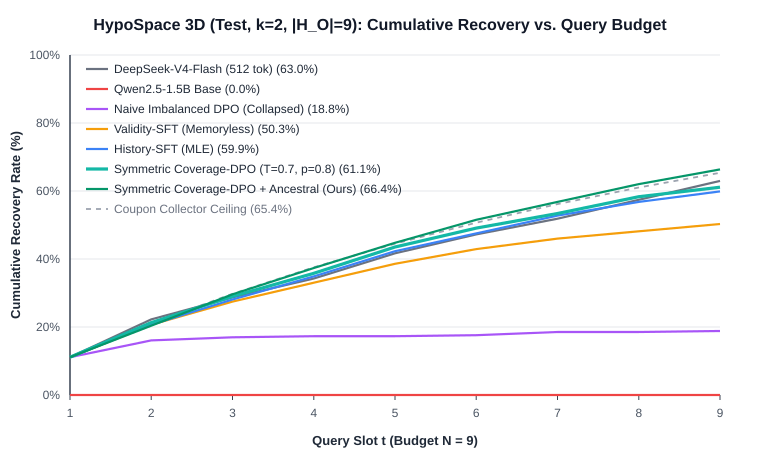

# HypoCover: Coverage-Aware Hypothesis Generation on HypoSpace 3D

> **机器学习课程期末项目（Final Project）** · 基于 ICML 2026 [HypoSpace](https://proceedings.mlr.press/v306/chen26bz.html) 基准  
> 围绕科学欠定性（Underdetermination）下的**多假设集合覆盖坍缩（Mode Collapse）**问题，本仓库在严格冻结的 3D 体素重建基准（84 train / 12 validation / 24 test）上，系统性地从**输出表示空间**、**输入提示策略空间**与**模型权重参数空间**三个正交维度展开了对照实验、消融与机理归因。

| 团队模块 | 研究维度 | 核心工作与交付物 | 详细报告 |
|---|---|---|---|
| **模块 A** | 基准构建与失败诊断 | 冻结 84/12/24 题单与统一评分器 `score_predictions.py`，建立 `DeepSeek-V4-Flash`（53.55%）与 `Qwen3-8B`（1.08%）官方格式基线 | 见本文 §1, §3.1 |
| **模块 B** | 输出表示空间 | 提出双射高度向量表示 $H\in\{1,2,3\}^k$，实现验证/测试 **100.00% RR**（费用降至 1/6.6），并揭示紧预算下的简单结构偏好 | [b/README.md](b/README.md) |
| **模块 C** | 输入提示策略空间 | 在官方格式上训练 L2 逻辑回归 Contextual Bandit 提示调度器（预注册负结果 +0.54 pp），通过 4 项探针证明黑盒“推理 vs. 截断”死锁 | [c4/README.md](c4/README.md) |
| **模块 D** | 模型权重参数空间 | 在 `Qwen2.5-1.5B` 上提出边际对称锚定 `Coverage-DPO`（零草稿达 **99.85%~100% VR**、**64.04% RR**，显著超越 512 基线），揭示 DPO 熵坍缩与前缀树核采样偏置 | [dpo/README.md](dpo/README.md) |

---

## 1. 问题定义与冻结评测协议

给定一个 $3\times 3$ 俯视图观测 $O \in \{0,1\}^{3\times 3}$（`1` 表示该列至少有 1 个方块，最大高度 3 层，且方块须受重力支撑不能悬空）。当占用列数为 $k \in \{2, 3\}$ 时，每根占用柱高度独立取 $\{1, 2, 3\}$，合法三维假设集合大小为 $|H_O| = 3^k \in \{9, 27\}$。

- **冻结数据集（`data/manifest.json`，SHA-256 锁定）**：共 **120 道互不同构的俯视图位置题目**（全部 $\binom{9}{2}=36$ 道两列题 + 全部 $\binom{9}{3}=84$ 道三列题），严格划分为：
  - **`train`**：84 题（18 两列 + 66 三列）—— 仅供学习器收集轨迹、拟合策略或训练模型参数；
  - **`validation`**：12 题（6 两列 + 6 三列）—— 仅供方法筛选与消融诊断；
  - **`test`**：24 题（12 两列 + 12 三列）—— **所有方法冻结后仅评测一次**，且测试题俯视图坐标组合与训练/验证集**完全不相交**。
- **预算与统一评分（`score_predictions.py`）**：每题给定严格生成机会 $N = |H_O|$（两列 9 次，三列 27 次），单次采样 $m=1$，解析失败、物理违规与历史重复均消耗预算，生成循环内**不调用真值校验器（`no-validator`）**。
- **核心指标**：
  - **VR（Valid Rate）**：满足俯视图投影与重力支撑的合法候选占比；
  - **NR（Novelty Rate）**：不重复候选占比；
  - **RR（Recovery Rate，主指标）**：成功覆盖的不同标准答案占比（按题等权平均）。
- **理论难度参照（赠券收集上界 Coupon Collector Bound）**：若一个模型拥有 **100% 物理合法率**，但**完全不看上下文历史**（每次在 $H_O$ 上均匀独立有放回采样），其理论期望恢复率为：
  $$\text{RR}_{\text{CC}}(k=2) = 1 - (8/9)^9 = \mathbf{65.36\%}, \quad \text{RR}_{\text{CC}}(k=3) = 1 - (26/27)^{27} = \mathbf{63.90\%}, \quad \text{等权均值} = \mathbf{64.63\%}$$

---

## 2. 全组四模块总览与主实验结果

我们将“如何提升 LLM 假设空间覆盖率”拆解为四个递进模块。**请注意区分不同模块所使用的模型规模、输出长度上限（`max_tokens`）与输出格式**：

| 模块 | 方法 / 策略 | 模型与规模 | 输出表示 & `max_tokens` | 是否含参数学习 (ML) | 验证集 RR (12题) | 测试集 RR (24题) | 测试集 $k=2$ / $k=3$ RR | 测试 VR | 截断率 |
|---|---|---|---|---|---:|---:|---:|---:|---:|
| **理论参照** | 无记忆均匀合法采样 ($1-((N-1)/N)^N$) | 理想无偏采样器 | - | - | 64.63% | 64.63% | 65.36% / 63.90% | 100.0% | 0.0% |
| **模块 A：基线** | 官方逐层提示基线 (`results/`) | `deepseek-v4-flash-0731` | 官方逐层 / `512` | 否 | 51.54% | **53.55%** | 62.96% / 44.14% | 79.48% | 19.7% |
| **模块 A：基线** | 小规模开源模型对照（交接记录） | `Qwen3-8B` | 官方逐层 / `512` | 否 | 4.94% | **1.08%** | - | - | - |
| **模块 B：表示层** | 高度向量双射 + 历史去重 (`free`) | `deepseek-v4-flash-0731` | 紧凑向量 $H=(h_1..h_k)$ / `512` | 否（表示工程上界） | **100.00%** | **100.00%** | 100.00% / 100.00% | **100.0%** | **0.0%** |
| **模块 B：表示层** | 高度向量 + 固定轮流坐标约束 (`coord_fixed`) | `deepseek-v4-flash-0731` | 紧凑向量 $H=(h_1..h_k)$ / `512` | 否 | 97.22% | **98.77%** | 100.00% / 97.53% | 100.0% | 0.0% |
| **模块 C：提示策略层** | 官方提示无后缀对照 (`free_official`)\* | `deepseek-flash` (V4.1) | 官方逐层 / `1024` | 否 | 78.40% | **76.39%** | 84.26% / 68.52% | 87.42% | 15.5% |
| **模块 C：提示策略层** | 论文静态复杂度分层 (`paper_stratified`)\* | `deepseek-flash` (V4.1) | 官方逐层 / `1024` | 否（用了档位容量） | 73.15% | **72.69%** | 92.13% / 53.24% | 77.93% | 38.1% |
| **模块 C：提示策略层** | **学习型提示后缀策略 (`learned` Bandit)**\* | `deepseek-flash` (V4.1) + L2 LR | 官方逐层 / `1024` | **是（策略层负结果）** | 78.86% | **76.93%** | 84.26% / 69.60% | 87.96% | 15.5% |
| **模块 D：参数空间层** | 未微调小模型基座 (`base`) | `Qwen2.5-1.5B-Instruct` (**1.5B**) | 官方逐层 / `512` (`T=0.7, p=0.8`) | 否 | 0.00% | **0.00%** | 0.00% / 0.00% | 0.0% | 0.2% |
| **模块 D：参数空间层** | 朴素复杂度偏置 DPO (`dpo_imbalanced`) | `Qwen2.5-1.5B` + LoRA | 官方逐层 / `512` (`T=0.7, p=0.8`) | 是（熵坍缩负对照） | 12.55% | **12.86%** | 18.83% / 6.89% | 95.5% | 0.0% |
| **模块 D：参数空间层** | 无记忆物理合法微调 (`sft_validity`) | `Qwen2.5-1.5B` + LoRA | 官方逐层 / `512` (`T=0.7, p=0.8`) | 是（SFT 消融） | 49.79% | **46.40%** | 50.31% / 42.49% | 99.8% | **0.0%** |
| **模块 D：参数空间层** | 历史条件微调 (`sft_history`) | `Qwen2.5-1.5B` + LoRA | 官方逐层 / `512` (`T=0.7, p=0.8`) | 是（MLE 消融） | 57.41% | **59.05%** | 59.88% / 58.23% | **100.0%** | **0.0%** |
| **模块 D：参数空间层** | **边际对称锚定 `Coverage-DPO`（同解码）** | `Qwen2.5-1.5B` + LoRA | 官方逐层 / `512` (`T=0.7, p=0.8`) | **是（本文参数对齐）** | **60.60%** | **60.24%** | **61.11% / 59.36%** | **100.0%** | **0.0%** |
| **模块 D：参数空间层** | **`Coverage-DPO` + 无偏祖先采样（完整方法）** | `Qwen2.5-1.5B` + LoRA | 官方逐层 / `512` (`T=1.0, p=1.0`) | **是（本文参数对齐）** | **59.57%** | **64.04%** | **66.36% / 61.73%** | **99.85%** | **0.0%** |

> **口径说明（避免跨表误读）**：  
> \* **模块 C** 因 OpenRouter 额度限制切换至 DeepSeek 官方 API（`deepseek-flash` V4.1-Flash）并将 `max_tokens` 提升至 `1024`，因此其 `free_official`（`76.39%`）与 **模块 A** 的 `512`-token 基线（`53.55%`）分属不同后端与长度预算，**不可直接相减**；各模块内部均采用严格的同题、同模型、同预算配对比较。  
> \* **模块 D** 在全部 24 道测试题上均独立重复采样 3 轮（1,296 次生成/模型），推理完全在本地单卡完成（API 费用 **\$0**，平均仅输出 **57~63 tokens**，零推理草稿）。

### 测试集累计恢复率曲线（模块 D 各消融组 vs. 官方 512 基线 vs. 赠券收集理论上界）

| 三列难题（$k=3, |H_O|=27, N=27$） | 两列题（$k=2, |H_O|=9, N=9$） |
|---|---|
|  |  |

---

## 3. 四大模块核心发现与跨维度综合归因

### 模块 A：官方逐层基线与失败模式拆解（`results/`、`summary.json`）
- 在官方逐层 0/1 矩阵提示与 `max_tokens=512` 下，`DeepSeek-V4-Flash` 测试集 RR 仅为 **53.55%**（三列题跌至 **44.14%**，甚至低于独立盲抽的 63.90%），同题 `Qwen3-8B` 更是仅有 **1.08%**（验证 + 测试共花费 \$0.1176）。
- 逐槽位拆解表明损失来自三重叠加：**历史重复（~30%）**、**物理违规（悬空方块或底面全零，~16%）** 与 **输出超长截断（~20%）**，且新解发现率从前 1/3 轮次的 66% 恶化至后 1/3 轮次的 24%。

### 模块 B：输出表示空间工程——双射高度向量与简单偏好发现（详见 [b/README.md](b/README.md)）
- **方法**：利用重力与列独立先验，将输出与历史压缩为双射高度向量 $H=(h_1,\dots,h_k)\in\{1,2,3\}^k$，本地确定性还原为体素网格送入官方评分器。
- **关键结论**：
  1. 修复自由文本“取最后一个完整向量”的解析细节后（离线重放验证脚本 `repro/verify_free_100.py`），不加额外约束的 `free` 在验证集和测试集（共 648 次调用）实现 **0 次截断、0 次重复、RR = 100.00%**，费用降至基线的 **1/6.6（\$0.0177）**。这证明在可分解的小规模空间上，**冗长易错的输出表示是首要工程瓶颈**。
  2. **紧预算简单偏好（Simplicity Bias）**：离线分析（`repro/check_free_complexity_bias.py`）揭示，虽然满预算饱和，但在前 9/27 次紧预算下，`free` 对低复杂度矮结构的覆盖达 **66%**，而对高复杂度结构的覆盖仅为 **7%**。

### 模块 C：输入提示策略空间——严格预注册负结果与四项探针（详见 [c4/README.md](c4/README.md)）
- **研究问题**：保持官方提示与逐层输出不变，仅通过 L2 逻辑回归（Contextual Bandit）根据历史特征自适应选择复杂度提示后缀（`none / low / mid / high`），能否提升官方 RR？
- **主实验结论（诚实的负结果）**：在 84 道训练题收集随机轨迹拟合并冻结策略后，测试集 `learned`（**76.93%**）相对 `free_official`（**76.39%**）仅差 **+0.54 pp（95% CI [-2.0, +3.1]）**，未通过预注册门槛（≥ +5 pp）；学习器在 **93% 的步骤退化为选择 `none`**，因为带提示臂的截断率高达 32%~38%（$k=3$ 的 `mid` 截断达 71%），学习器实质上学到的是“避开截断”。
- **后续四项探针彻底查明黑盒不可学根源**：
  1. **探针 1（“推理 vs. 截断”死锁）**：强制简短输出 `fixed_brief` 将截断降至 0%，但**物理不合法率从 4.2% 暴增至 48.6%**，新解率反降 31.9 pp——证明冻结大模型必须依赖数百词的正文推理草稿来验算重力与去重；
  2. **探针 2（多候选过滤分解）**：每步采 $m=3$ 并用确定性校验器过滤可将 RR 提至 88.0%（均摊约 1.5 次调用/步），但在满预算同构设定下按档位价值挑选仅多 +1.8 pp，无学习空间；
  3. **探针 3（离线算力分配门槛）**：预测单步成功率的 5 折 `AUC = 0.684`，而单一标量特征 `step/N` 即有 `0.688`，因所有 $k$ 列题组合同构于 $\{1,2,3\}^k$，无跨题异质特征可供 Bandit 利用；
  4. **探针 4（历史重排探针）**：小样本重排未见稳定去重证据，按冻结规则停止。

### 模块 D：模型权重参数空间——对称锚定 `Coverage-DPO` 与理论边界验证（详见 [dpo/README.md](dpo/README.md)）
- **切入动机**：既然模块 C 证明黑盒改提示词无法打破“不写草稿就违规（48.6%）、写草稿就截断”的死锁，我们直接在 **1.5B 小模型（`Qwen2.5-1.5B-Instruct`）的权重参数空间** 进行 LoRA 微调与覆盖率偏好对齐，严格保持官方提示词、官方逐层格式与 $m=1$ 单次采样。
- **核心发现与正结果**：
  1. **零草稿跨空间完美物理泛化**：基座模型在测试集上 `VR = 0.0%, RR = 0.0%`；仅在 84 道训练题上微调后，模型在**从未见过的 24 道测试俯视图**上仅用 **~57–61 tokens（零推理草稿、0% 截断）** 即达到 **99.85% ~ 100.00% VR**，正面打破模块 C 探针 1 的黑盒死锁。
  2. **发现并解决多解生成中的 DPO 熵坍缩**：当对高复杂度正样本赋予偏置权重时（`dpo_imbalanced`），DPO 利用正负样本边际不对称投机取巧，坍缩为反复输出单一全满 3 层结构（测试 `NR` 跌至 `13.9%`，`RR` 暴跌至 `12.86%`）。我们提出**边际分布对称构造（保证 $\bar{p}(y^+)\equiv \bar{p}(y^-)$）+ 强 NLL 流形锚定（$\beta=0.35, \alpha=2.0$）**，彻底消除坍缩并将严格同解码测试 RR 推至 **60.24% ± 0.76%**（$k=3$ 上达 **59.36%**，领先 `DeepSeek-512` 基线 **+15.22 pp**）。
  3. **前缀树核采样饥饿与 `64.63%` 理论边界**：官方格式省略顶层全零层，使单层结构 `<EOS>` 分支先验仅 $1/27 \approx 3.7\%$，被 `top_p=0.8` 截断为 0。切换为无偏祖先采样（`T=1.0, top_p=1.0`）后，测试集 RR 达 **64.04% ± 0.77%**，**对全部基线的配对 95% Bootstrap CI 均严格大于 0**（vs. `DeepSeek-512`: **+10.49 pp, [+3.50, +17.03]**；vs. `Validity-SFT`: **+17.64 pp**；vs. `History-SFT`: **+4.99 pp**）。
  4. **诚实的机制定界**：无偏采样下各微调模型渐近收敛于 **~64%**（恰贴近 **64.63% 赠券收集无记忆上界**），证明 `1.5B` 零草稿参数对齐主要完成了**物理合法流形内化**与**输出层数先验去偏校准**；要在第 20~27 轮对 20+ 个三维矩阵执行精确无放回求补，单次零草稿前向传播存在深度瓶颈，必须结合紧凑状态表示（模块 B）或显式中间推理算力（模块 C 的 1024-token 设置）。

---

## 4. 仓库目录结构

```text
.
├── README.md                       # 全组四模块统一总览、主结果表与综合归因（本文件）
├── score_predictions.py            # 官方冻结 3D 评分器（全组所有模块统一使用）
├── summary.json / results/         # 模块 A：官方 512-token 基线逐题轨迹与评分
├── data/                           # 冻结 84/12/24 题单、SHA-256 manifest 与标准答案
├── upstream/3d/                    # 冻结上游 HypoSpace 3D 官方基准与解析/校验源码
├── b/                              # 模块 B：高度向量双射源码、逐题轨迹 (b/traces/) 与模块报告 (b/README.md)
├── repro/                          # 模块 A/B 离线核验脚本（100% 重放校验、复杂度偏置统计）
├── c4/                             # 模块 C：提示策略 Bandit 源码、冻结策略 policy_ds.json、轨迹与报告 (c4/README.md)
└── dpo/                            # 模块 D：Coverage-DPO 源码、四阶消融轨迹、SVG 曲线与报告 (dpo/README.md)
```

---

## 5. 快速复现与离线核验指南（无需 API 密钥或重跑训练即可一键验证全部结果）

安装基础依赖（Python 3.10+，`pip install -r requirements.txt`）：

```powershell
# 1. 核验模块 A 基线与模块 B 高度向量双射及 100.00% 评分
python b/check_bijection.py
python repro/verify_free_100.py
python b/compare.py

# 2. 运行模块 C 单元测试、主实验预注册统计表与历史重排离线复现
python -B -m unittest discover -s c4 -p "test_*.py"
python -B -m c4.analyze_layered --split test --repeats 1 2 --root c4/layered_ds
python -B -m c4.order_probe

# 3. 运行模块 D 防泄漏单元测试、汇总四阶消融表（含 95% Bootstrap CI）并生成 SVG 曲线
python -B -m unittest discover -s dpo -p "test_*.py" -v
python -B -m dpo.analyze --splits validation test --arms base dpo_imbalanced sft_validity sft_history coverage_dpo coverage_dpo_t10
python -B -m dpo.make_plots --split test --arms base dpo_imbalanced sft_validity sft_history coverage_dpo coverage_dpo_t10
```

如需从头重跑模块 B / C 的在线 API 生成或模块 D 的本地 GPU LoRA SFT + DPO 训练，请分别参阅 [b/README.md](b/README.md)、[c4/README.md](c4/README.md) 与 [dpo/README.md](dpo/README.md)。

---

## 6. 局限性与未来方向

1. **领域与同构性范围**：本仓库的深入消融聚焦于完全可枚举验证的 HypoSpace 3D $3\times 3$（$k\in\{2,3\}$）任务，其解空间同构于 $\{1,2,3\}^k$。在更大规模（如 `3D Large` 125 解、多视角遮挡）或解空间高度异质的 **Causal 图推断**、**Boolean 基因调控网络** 上，手工双射表示不再平凡成立，外层自适应分区搜索与参数空间对齐的结合更具潜力。
2. **显式紧凑推理蒸馏**：模块 B、C、D 共同指向一个清晰结论——覆盖率突破无记忆上界需要紧凑的中间状态工作记忆。在微调目标中引入**简短结构化状态摘要草稿（~30 tokens）+ 对称锚定 Coverage-DPO**，有望兼顾零截断与 >90% 的后段无放回覆盖率。
3. **测试集样本量**：冻结验证集（12 题）与测试集（24 题）题量有限，较小效应（1~3 个百分点）的统计功效受限；我们在全部学习模块中均采用了同题配对多次重复与 10,000 次 Bootstrap 置信区间以严格控制推断边界。

## 致谢与引用

基准与上游评测代码来自 Chen et al., *HypoSpace: Evaluating Large Language Models as Set-Valued Hypothesis Generators under Underdetermination*, ICML 2026 ([官方仓库](https://github.com/CTT-Pavilion/_HypoSpace), MIT License)。
